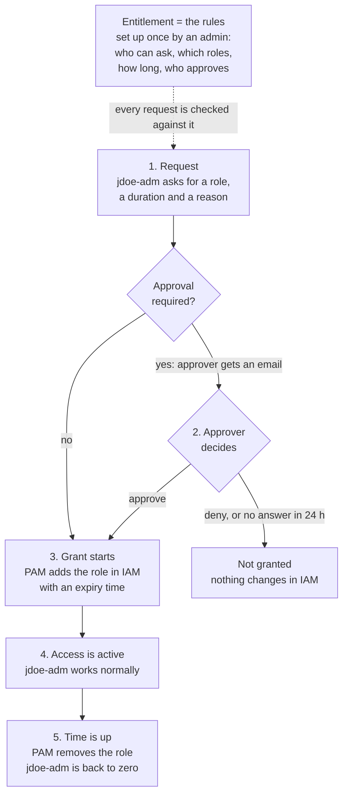
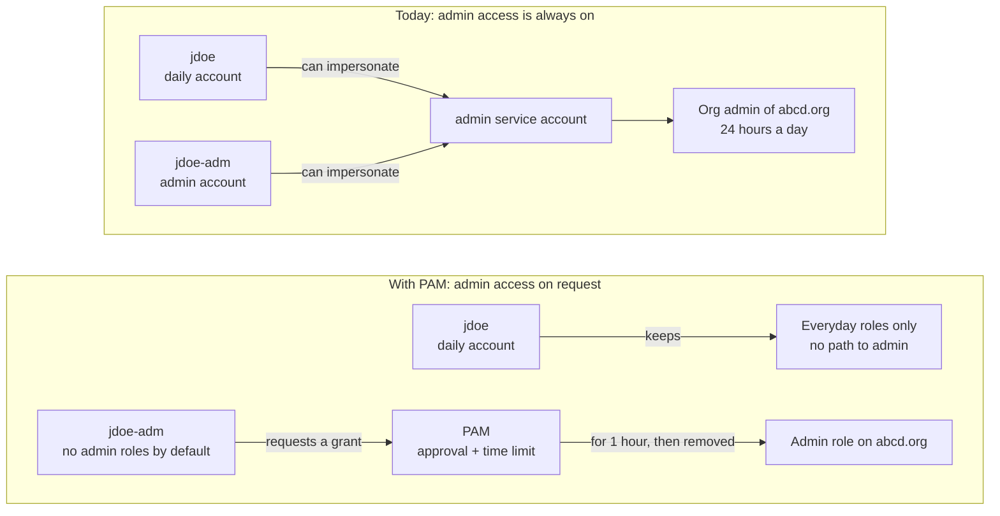
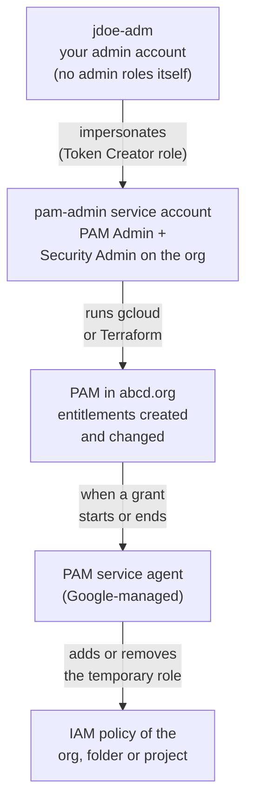
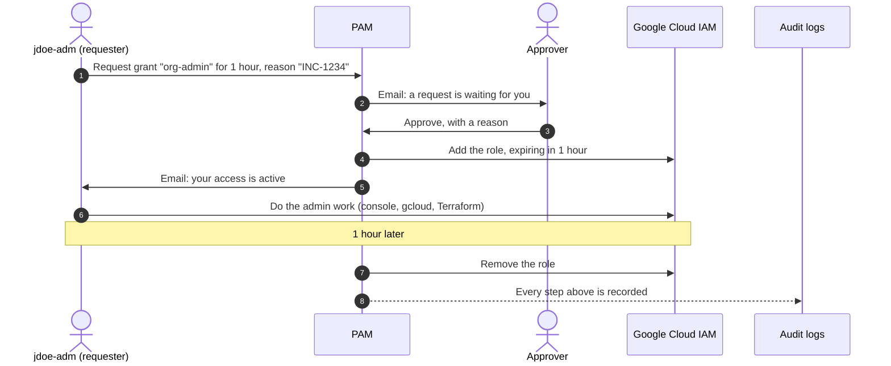
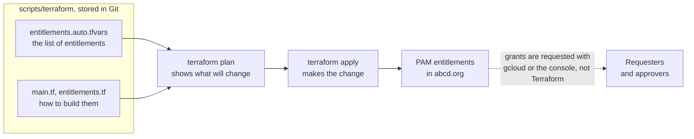
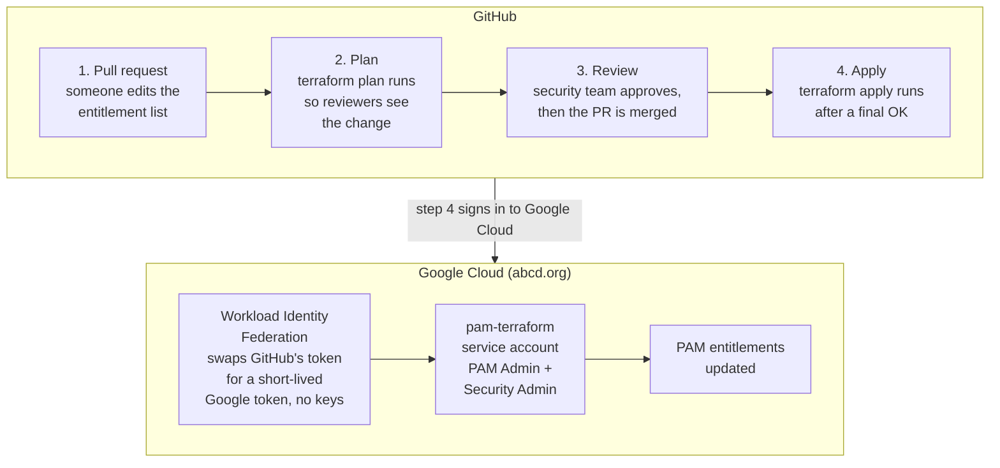

# How Google Cloud PAM Works

A beginner's, high-level guide to **Privileged Access Manager (PAM)** for abcd.org.
Written October 2026.

**In one sentence:** PAM replaces always-on admin rights with access you request only
when you need it. Access lasts a set time, can require someone's approval, and Google
removes it automatically when the time runs out.

Think of it as borrowing the master key from the front desk: you sign the sheet and say
why, someone OKs it, and the key takes itself back after an hour.

Want to try it yourself? [TRY-PAM.md](TRY-PAM.md) is a hands-on lab in a throwaway project.

**Contents**

1. [How PAM works](#1-how-pam-works)
2. [Key terms](#2-key-terms)
3. [Your setup: before and after](#3-your-setup-before-and-after)
4. [Setting up PAM with an impersonated account](#4-setting-up-pam-with-an-impersonated-account)
5. [How a user requests access](#5-how-a-user-requests-access)
6. [Managing PAM with Terraform](#6-managing-pam-with-terraform)
7. [Running Terraform from GitHub](#7-running-terraform-from-github)
8. [Safety rules](#8-safety-rules)
9. [Limits at a glance](#9-limits-at-a-glance)

---

## 1. How PAM works



What happens underneath is ordinary IAM. When a grant starts, PAM's service agent adds a
normal role binding to the org, folder or project, with a time limit attached (an IAM
condition). When the time is up, PAM deletes the binding. Every step (request, approval,
start, end) is written to **Cloud Audit Logs**.

## 2. Key terms

| Term | What it is | Example |
|---|---|---|
| **Entitlement** | The rules: who may ask, for which roles, for how long, and who approves. Created once by an admin. | `org-admin`: jdoe-adm may get Organization Administrator for up to 2 hours, approved by the approvers group |
| **Grant** | One request made against an entitlement. | "Give me `org-admin` for 1 hour, for INC-1234" |
| **Requester** | The person asking. Needs no special role, only to be listed in the entitlement. | `user:jdoe-adm@abcd.org` |
| **Approver** | Person or group who approves or denies. Nobody can approve their own request. | `group:gcp-pam-approvers@abcd.org` |
| **PAM admin** | Whoever creates entitlements. Needs PAM Admin plus Security Admin on the org. | The `pam-admin` service account (section 4) |
| **PAM service agent** | Google-managed account that adds and removes the temporary roles. | `service-org-ORG_NUMBER@gcp-sa-pam.iam.gserviceaccount.com` |

## 3. Your setup: before and after



Why this matters:

- **Phishing:** today, whoever steals jdoe's session can impersonate the admin service account and
  become org admin. With PAM, they get everyday rights only.
- **Exposure:** admin rights exist for about an hour at a time instead of all day, every day.
- **Accountability:** every use of admin rights has a name, a reason and an approver in the logs.

## 4. Setting up PAM with an impersonated account

The idea: no person holds PAM admin rights directly. A service account, `pam-admin`, holds
them, and jdoe-adm borrows them by impersonating it.



**One-time setup** (bash syntax; in PowerShell use a backtick instead of `\` and `$env:` for variables):

```bash
ORG_ID=123456789012
ADMIN_PROJECT=abcd-security-admin
PAM_SA=pam-admin@${ADMIN_PROJECT}.iam.gserviceaccount.com

# Steps 1-3 are run once by someone who is an org admin today.

# 1. Turn on the PAM API and create the service account
gcloud services enable privilegedaccessmanager.googleapis.com --project=$ADMIN_PROJECT
gcloud iam service-accounts create pam-admin --project=$ADMIN_PROJECT \
  --display-name="PAM administrator"

# 2. Give the service account the two roles PAM admins need, on the org
gcloud organizations add-iam-policy-binding $ORG_ID \
  --member="serviceAccount:$PAM_SA" --role="roles/privilegedaccessmanager.admin"
gcloud organizations add-iam-policy-binding $ORG_ID \
  --member="serviceAccount:$PAM_SA" --role="roles/iam.securityAdmin"

# 3. Let jdoe-adm (and nobody else) impersonate it
gcloud iam service-accounts add-iam-policy-binding $PAM_SA \
  --member="user:jdoe-adm@abcd.org" --role="roles/iam.serviceAccountTokenCreator"

# 4. As jdoe-adm: act as the service account from now on
gcloud config set auth/impersonate_service_account $PAM_SA

# 5. Give the PAM service agent its role, then check that setup is complete
gcloud organizations add-iam-policy-binding $ORG_ID \
  --member="serviceAccount:service-org-${ORG_ID}@gcp-sa-pam.iam.gserviceaccount.com" \
  --role="roles/privilegedaccessmanager.serviceAgent"
gcloud pam check-onboarding-status --organization=$ORG_ID --location=global

# 6. Create an entitlement from a YAML file (example below)
gcloud pam entitlements create org-admin \
  --entitlement-file=org-admin.yaml --location=global --organization=$ORG_ID

# When you are done, stop impersonating
gcloud config unset auth/impersonate_service_account
```

**Example entitlement file**, `org-admin.yaml`:

```yaml
privilegedAccess:
  gcpIamAccess:
    resourceType: cloudresourcemanager.googleapis.com/Organization
    resource: //cloudresourcemanager.googleapis.com/organizations/123456789012
    roleBindings:
    - role: roles/resourcemanager.organizationAdmin
maxRequestDuration: 7200s          # longest grant allowed: 2 hours
eligibleUsers:
- principals:
  - user:jdoe-adm@abcd.org         # who can ask
approvalWorkflow:
  manualApprovals:
    requireApproverJustification: true
    steps:
    - approvalsNeeded: 1
      approvers:
      - principals:
        - group:gcp-pam-approvers@abcd.org   # who approves
requesterJustificationConfig:
  unstructured: {}                 # requester must type a reason
```

> **Note:** jdoe-adm's right to impersonate `pam-admin` is itself always-on access. Once the
> GitHub pipeline in section 7 is running, remove it. Or make it a PAM entitlement of its own,
> approved by someone else.

## 5. How a user requests access



**As the requester (jdoe-adm):**

- **Console:** search for *Privileged Access Manager* in the Google Cloud console, choose the
  org (or folder or project) at the top, find the entitlement and request a grant with a
  duration and a reason.
- **gcloud:**

  ```bash
  # What can I request?
  gcloud pam entitlements search --caller-access-type=grant-requester \
    --location=global --organization=$ORG_ID

  # Ask for 1 hour
  gcloud pam grants create --entitlement=org-admin --requested-duration=3600s \
    --justification="INC-1234: fix IAM on prod folder" \
    --location=global --organization=$ORG_ID

  # Check the status of my requests
  gcloud pam grants search --entitlement=org-admin --caller-relationship=had-created \
    --location=global --organization=$ORG_ID
  ```

**As the approver:** use the link in the email, the console, or gcloud:

```bash
gcloud pam grants search --entitlement=org-admin --caller-relationship=can-approve \
  --location=global --organization=$ORG_ID
gcloud pam grants approve GRANT_ID --entitlement=org-admin --reason="OK for INC-1234" \
  --location=global --organization=$ORG_ID
gcloud pam grants deny GRANT_ID --entitlement=org-admin --reason="No ticket" \
  --location=global --organization=$ORG_ID
```

Good to know:

- A request nobody answers expires after **24 hours**.
- After approval, access takes a minute or two to work (normal IAM delay).
- Access ends on its own. A PAM admin can end it early with `gcloud pam grants revoke`.
- If the entitlement grants **Token Creator** on a service account, you then use that
  account as usual, for example `gcloud ... --impersonate-service-account=SA_EMAIL`.

## 6. Managing PAM with Terraform

The idea: **Terraform manages the entitlements (the rules), not the grants (the requests).**
Entitlements change rarely and should be reviewed. Grants happen every day and are short-lived.



**What is in this repo:**

```
scripts/terraform/
├── versions.tf               provider settings
├── main.tf                   turns on PAM and gives the service agent its role
├── entitlements.tf           builds one entitlement per entry in the list
├── variables.tf, outputs.tf  inputs and outputs
└── terraform.tfvars.example  example entitlements to copy
```

**Adding an entitlement** is one entry in the list:

```hcl
"org-admin" = {
  parent               = "organizations/123456789012"
  roles                = [{ role = "roles/resourcemanager.organizationAdmin" }]
  eligible_principals  = ["user:jdoe-adm@abcd.org"]
  approver_principals  = ["group:gcp-pam-approvers@abcd.org"]   # leave out for no approval
  max_request_duration = "7200s"
}
```

**Running it from your machine, as the impersonated `pam-admin` account:**

```bash
cd scripts/terraform
export GOOGLE_IMPERSONATE_SERVICE_ACCOUNT=pam-admin@abcd-security-admin.iam.gserviceaccount.com
terraform init
terraform plan     # read what will change
terraform apply    # make the change
```

In PowerShell, set the variable with
`$env:GOOGLE_IMPERSONATE_SERVICE_ACCOUNT = "pam-admin@abcd-security-admin.iam.gserviceaccount.com"`.

For the GitHub flow below, the entitlement list has to be in Git. Save it as
`scripts/terraform/entitlements.auto.tfvars`: Terraform loads `*.auto.tfvars` files on its own,
and the list holds no secrets. `terraform.tfvars` stays git-ignored for local experiments.

## 7. Running Terraform from GitHub

The idea: **nobody runs `terraform apply` by hand.** A change to PAM is a pull request. The
security team reviews it, and GitHub Actions applies it.



**One-time pieces:**

1. **A Cloud Storage bucket for Terraform state**, so every run sees the same state. Add a
   `backend "gcs"` block to `versions.tf`.
2. **A `pam-terraform` service account** with PAM Admin and Security Admin on the org.
3. **Workload Identity Federation:** a pool with a GitHub provider limited to your repo,
   allowed to impersonate `pam-terraform` (`roles/iam.workloadIdentityUser`). This replaces
   downloaded key files.
4. **Branch protection on `main`:** require a review, with a `CODEOWNERS` rule making the
   security team the owner of `scripts/terraform/`.
5. **A GitHub environment called `production`** with required reviewers. The apply job waits
   for their OK.

**Workflow file**, `.github/workflows/pam-terraform.yml`:

```yaml
name: pam-terraform

on:
  pull_request:
    paths: ["scripts/terraform/**"]
  push:
    branches: [main]
    paths: ["scripts/terraform/**"]

permissions:
  contents: read
  id-token: write   # lets the job get a GitHub token to swap for a Google token

env:
  WIF_PROVIDER: projects/PROJECT_NUMBER/locations/global/workloadIdentityPools/github/providers/github
  TF_SA: pam-terraform@abcd-security-admin.iam.gserviceaccount.com

jobs:
  plan:
    if: github.event_name == 'pull_request'
    runs-on: ubuntu-latest
    defaults:
      run:
        working-directory: scripts/terraform
    steps:
      - uses: actions/checkout@v4
      - uses: google-github-actions/auth@v2
        with:
          workload_identity_provider: ${{ env.WIF_PROVIDER }}
          service_account: ${{ env.TF_SA }}
      - uses: hashicorp/setup-terraform@v3
      - run: terraform init -input=false
      - run: terraform plan -input=false

  apply:
    if: github.event_name == 'push'
    runs-on: ubuntu-latest
    environment: production   # waits for a required reviewer
    defaults:
      run:
        working-directory: scripts/terraform
    steps:
      - uses: actions/checkout@v4
      - uses: google-github-actions/auth@v2
        with:
          workload_identity_provider: ${{ env.WIF_PROVIDER }}
          service_account: ${{ env.TF_SA }}
      - uses: hashicorp/setup-terraform@v3
      - run: terraform init -input=false
      - run: terraform apply -input=false -auto-approve
```

Once this runs, remove jdoe-adm's right to impersonate `pam-admin` (section 4). The pipeline
is then the only way entitlements change.

## 8. Safety rules

- **Keep 1-2 break-glass accounts** outside PAM. They keep org admin permanently, use hardware
  security keys, have passwords stored offline, and send an alert on every sign-in. They are
  your way in if PAM breaks or no approver is around.
- **Roll out in this order:** set up PAM and break-glass first, test a full request (ask,
  approve, use, expire), and only then remove the always-on admin rights. The other way round
  can lock you out.
- **You need a second approver.** Nobody can approve their own request. If you are the only
  admin for now, use entitlements without an approval step. They are still time-limited and logged.
- **Never manage IAM with Terraform's `google_*_iam_policy` resources.** They replace the whole
  policy and wipe PAM's temporary roles. Use `google_*_iam_member` instead.
- **Keep the bypass list short.** Anyone with permanent rights to change org IAM, or with PAM
  Admin, can go around PAM. That includes the `pam-admin` and `pam-terraform` accounts, so guard
  who can impersonate them.
- **Watch admin grants.** Someone holding Organization Administrator for an hour could add
  themselves permanently in that hour. Alert on IAM changes. This Cloud Logging filter shows all
  PAM activity: `protoPayload.serviceName="privilegedaccessmanager.googleapis.com"`

## 9. Limits at a glance

| Setting | Limit |
|---|---|
| Grant duration | 30 minutes to 7 days |
| Unanswered request expires after | 24 hours |
| People or groups per requester or approver list | 20 (use groups for more) |
| Roles per entitlement | 30 |
| Open grants per entitlement | 10 |
| Roles not allowed | Owner, Editor, Viewer (legacy basic roles) |
| Needs Security Command Center Premium or Enterprise | Two-level approvals, requesting a narrower scope (both in preview) |

## Sources

- [PAM overview](https://docs.cloud.google.com/iam/docs/pam-overview)
- [PAM permissions and setup](https://docs.cloud.google.com/iam/docs/pam-permissions-and-setup)
- [Create entitlements](https://docs.cloud.google.com/iam/docs/pam-create-entitlements)
- [Request temporary elevated access](https://docs.cloud.google.com/iam/docs/pam-request-temporary-elevated-access)
- [Approve or deny grants](https://docs.cloud.google.com/iam/docs/pam-approve-deny-grants)
- [gcloud pam reference](https://docs.cloud.google.com/sdk/gcloud/reference/pam)
- [Terraform: google_privileged_access_manager_entitlement](https://registry.terraform.io/providers/hashicorp/google/latest/docs/resources/privileged_access_manager_entitlement)
