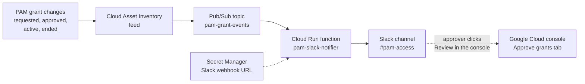

# Slack Notifications for PAM

Post every PAM request, approval and expiry to a Slack channel, so approvers see requests
right away and everyone can see admin activity in one place.

**What this does:** a message lands in `#pam-access` whenever a grant changes state. A new
request includes a link that takes the approver straight to the console.

**What this does not do:** people still **request** and **approve** in the Google Cloud console
(or gcloud). That is on purpose. PAM gives access to whoever calls it, so a bot that requested
or approved for people would get the access itself, or be named as the approver in the logs.
Here the bot only reads and posts, so it holds no power worth stealing.

New to PAM? Read [HOW-PAM-WORKS.md](HOW-PAM-WORKS.md) first.

---

## How it works



1. **Cloud Asset Inventory feed:** Google watches every PAM grant in the org and sends a
   message each time one changes.
2. **Pub/Sub topic:** a mailbox that receives those messages.
3. **Cloud Run function:** a small Python program
   ([`scripts/slack-notifier/main.py`](scripts/slack-notifier/main.py)). It reads each message,
   skips anything that isn't news, and posts the rest to Slack.
4. **Secret Manager:** stores the Slack webhook URL, so it never sits in code or Git.
5. **Slack incoming webhook:** a private URL that lets the function post to one channel.

## What the messages look like

A new request:

> **jdoe-adm@abcd.org**'s request for **org-admin** (1 h 30 min) is waiting for approval\
> Requester's reason: INC-1234: fix IAM on prod folder\
> Roles: roles/resourcemanager.organizationAdmin\
> [Review in the console](#) (Approve grants tab)

After approval:

> **jdoe-adm@abcd.org**'s request for **org-admin** (1 h 30 min) is now active\
> Approved by: approver@abcd.org\
> Their reason: OK for INC-1234\
> Requester's reason: INC-1234: fix IAM on prod folder\
> Roles: roles/resourcemanager.organizationAdmin

**Which changes are posted:**

| Grant state | Message says |
|---|---|
| `APPROVAL_AWAITED` | is waiting for approval, with the console link |
| `ACTIVE` | is now active, with who approved it and their reason |
| `DENIED` | was denied, with who denied it and their reason |
| `REVOKED` | was revoked, with who revoked it and their reason |
| `WITHDRAWN` | was withdrawn by the requester |
| `EXPIRED` | expired without a decision (nobody answered within 24 hours) |
| `ACTIVATION_FAILED` | failed to activate |
| `ENDED` | has ended (time ran out) |

Short in-between states (`SCHEDULED`, `ACTIVATING`, `REVOKING`, `WITHDRAWING`) are skipped,
because the state after them is the news.

---

## Before you start

- **Slack:** permission to create an app in your workspace, or a Slack admin who can do step 1.
- **Google Cloud:**
  - a project to run the notifier in. These steps use `abcd-security-admin`.
  - **Owner** on that project.
  - **Cloud Asset Owner** (`roles/cloudasset.owner`) on the organization, to create the feed.
- **Where to run the commands:** [Cloud Shell](https://shell.cloud.google.com) is easiest. It is
  bash with gcloud already signed in. Clone this repo there so step 7 can find the function code.

## Step 1: Create the Slack channel and webhook

1. In Slack, create a **private** channel called `#pam-access`. Invite your approvers and the
   security team.
2. Go to <https://api.slack.com/apps>, click **Create New App**, choose **From scratch**, name it
   `PAM notifier` and pick your workspace.
3. In the app's settings, open **Incoming Webhooks** and switch **Activate Incoming Webhooks** on.
4. Click **Add New Webhook**, choose `#pam-access`, then **Allow**.
5. Copy the webhook URL (`https://hooks.slack.com/services/...`).

> **Treat the webhook URL like a password.** Anyone who has it can post into the channel.
> Don't paste it into chat, tickets or code.

## Step 2: Set variables and turn on the APIs

```bash
ORG_ID=123456789012
PROJECT_ID=abcd-security-admin
REGION=us-central1
PROJECT_NUMBER=$(gcloud projects describe $PROJECT_ID --format="value(projectNumber)")

gcloud services enable \
  cloudasset.googleapis.com pubsub.googleapis.com secretmanager.googleapis.com \
  cloudfunctions.googleapis.com run.googleapis.com eventarc.googleapis.com \
  cloudbuild.googleapis.com artifactregistry.googleapis.com \
  --project=$PROJECT_ID
```

## Step 3: Store the webhook URL in Secret Manager

This command asks for the URL without showing it, so it doesn't end up in your shell history:

```bash
read -rsp "Slack webhook URL: " WEBHOOK && echo
printf '%s' "$WEBHOOK" | gcloud secrets create pam-slack-webhook \
  --data-file=- --project=$PROJECT_ID
unset WEBHOOK
```

## Step 4: Create the Pub/Sub topic and let Cloud Asset Inventory publish to it

```bash
gcloud pubsub topics create pam-grant-events --project=$PROJECT_ID

# Make sure Cloud Asset Inventory's service agent exists and has its role
gcloud beta services identity create --service=cloudasset.googleapis.com --project=$PROJECT_ID
gcloud projects add-iam-policy-binding $PROJECT_ID \
  --member="serviceAccount:service-${PROJECT_NUMBER}@gcp-sa-cloudasset.iam.gserviceaccount.com" \
  --role="roles/cloudasset.serviceAgent"

# Let it publish to the topic
gcloud pubsub topics add-iam-policy-binding pam-grant-events --project=$PROJECT_ID \
  --member="serviceAccount:service-${PROJECT_NUMBER}@gcp-sa-cloudasset.iam.gserviceaccount.com" \
  --role="roles/pubsub.publisher"
```

## Step 5: Create the feed that watches PAM grants

```bash
gcloud asset feeds create pam-grants \
  --organization=$ORG_ID \
  --billing-project=$PROJECT_ID \
  --asset-types="privilegedaccessmanager.googleapis.com/Grant" \
  --content-type=resource \
  --pubsub-topic="projects/$PROJECT_ID/topics/pam-grant-events"
```

This watches grants on every entitlement in the org, including folder- and project-level ones.

## Step 6: Create a service account for the function

The function gets its own account. Its only right is reading the webhook secret: no PAM and no
IAM rights.

```bash
gcloud iam service-accounts create pam-slack-notifier \
  --display-name="PAM Slack notifier" --project=$PROJECT_ID
NOTIFIER_SA=pam-slack-notifier@${PROJECT_ID}.iam.gserviceaccount.com

gcloud secrets add-iam-policy-binding pam-slack-webhook --project=$PROJECT_ID \
  --member="serviceAccount:$NOTIFIER_SA" --role="roles/secretmanager.secretAccessor"
```

## Step 7: Deploy the function

Run this from the repo root:

```bash
gcloud functions deploy pam-slack-notifier \
  --gen2 --region=$REGION --runtime=python312 \
  --source=scripts/slack-notifier --entry-point=notify \
  --trigger-topic=pam-grant-events \
  --service-account=$NOTIFIER_SA \
  --trigger-service-account=$NOTIFIER_SA \
  --set-secrets="SLACK_WEBHOOK_URL=pam-slack-webhook:latest" \
  --project=$PROJECT_ID

# Allow the trigger to call the function
gcloud functions add-invoker-policy-binding pam-slack-notifier \
  --region=$REGION --member="serviceAccount:$NOTIFIER_SA" --project=$PROJECT_ID
```

The first deploy takes a few minutes while Google builds the function.

## Step 8: Test it

**1. A fake message.** This tests the function and Slack without involving PAM:

```bash
gcloud pubsub topics publish pam-grant-events --project=$PROJECT_ID --message='{
  "asset": {"resource": {"data": {
    "name": "organizations/123456789012/locations/global/entitlements/org-admin/grants/test-1",
    "requester": "jdoe-adm@abcd.org",
    "requestedDuration": "3600s",
    "state": "APPROVAL_AWAITED",
    "justification": {"unstructuredJustification": "Test message, please ignore"},
    "privilegedAccess": {"gcpIamAccess": {"roleBindings": [{"role": "roles/resourcemanager.organizationAdmin"}]}}
  }}}
}'
```

A "waiting for approval" message should appear in `#pam-access` within a few seconds.

**2. A real grant.** Request a short grant on a low-risk entitlement and check the channel.
Expect one message for the request, one when it is approved, and one when it ends. Feed
messages can take a minute or two to arrive.

**3. If nothing shows up**, read the function's logs:

```bash
gcloud functions logs read pam-slack-notifier --gen2 --region=$REGION \
  --project=$PROJECT_ID --limit=20
```

---

## Troubleshooting

| Problem | What to check |
|---|---|
| The fake message never reaches Slack | Function logs (step 8). A `403` or `404` from Slack means the webhook URL is wrong or was removed: add a new secret version with the right URL. |
| The fake message works, but real grants don't | Run `gcloud asset feeds list --organization=$ORG_ID` to check the feed exists. Check the publisher role from step 4. Wait a few minutes after creating the feed. |
| The deploy fails with a build permission error | Newer projects build functions as the default compute service account. Grant it `roles/cloudbuild.builds.builder`, or pass `--build-service-account` with an account that has that role. |
| The same message appears twice | Pub/Sub delivers each message at least once, so an occasional duplicate is expected. |

## Keeping it safe

- **Keep `#pam-access` private.** Messages show who asked for what and why.
- **Rotate the webhook if it leaks.** Remove it in the Slack app, add a new one, and store it with
  `printf '%s' "$NEW_URL" | gcloud secrets versions add pam-slack-webhook --data-file=-`.
- **The notifier account stays powerless.** Never give it PAM, IAM or project roles. It only
  needs to read the one secret.
- **Never put secrets in a grant's reason.** The reason is posted to the channel.

## Managing it with Terraform (optional)

Each step above has a matching resource in the Google Terraform provider, so this can live next
to the PAM config in `scripts/terraform/`:

| Step | Terraform resource |
|---|---|
| 2. APIs | `google_project_service` |
| 3. Secret | `google_secret_manager_secret` (add the URL itself by hand, so it never lands in Git or Terraform state) |
| 4. Topic and publisher role | `google_pubsub_topic`, `google_pubsub_topic_iam_member` |
| 5. Feed | `google_cloud_asset_organization_feed` |
| 6. Service account and secret access | `google_service_account`, `google_secret_manager_secret_iam_member` |
| 7. Function and invoker role | `google_cloudfunctions2_function`, `google_cloud_run_service_iam_member` |

## Sources

- [PAM overview](https://docs.cloud.google.com/iam/docs/pam-overview) (Cloud Asset Inventory feeds for grants)
- [PAM grant REST reference](https://docs.cloud.google.com/iam/docs/reference/pam/rest/v1/folders.locations.entitlements.grants) (grant fields and states)
- [Approve or deny grants](https://docs.cloud.google.com/iam/docs/pam-approve-deny-grants) (console steps for approvers)
- [Monitor asset changes with Pub/Sub](https://docs.cloud.google.com/asset-inventory/docs/monitoring-asset-changes)
- [Cloud Asset Inventory across projects](https://docs.cloud.google.com/asset-inventory/docs/multiple-projects) (service agent and publisher role)
