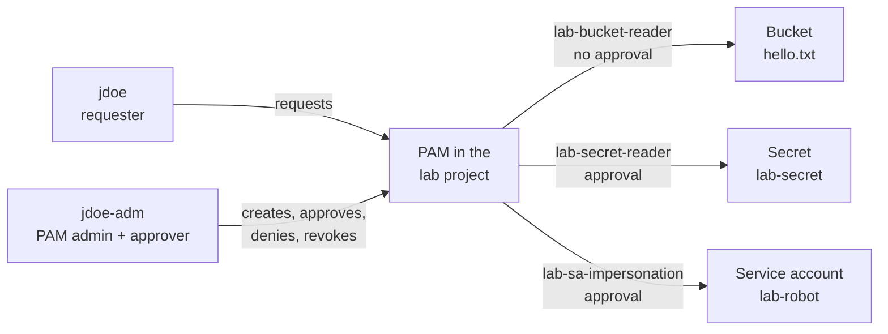
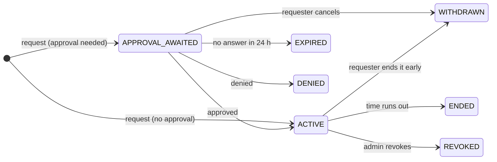

# Try PAM Yourself

A hands-on lab. You set up PAM in a throwaway project, then use it the way your team will: ask
for access, approve it, use it, and watch it go away. You play both people: **jdoe** asks for
access and **jdoe-adm** approves it. Written October 2026.

New to PAM? Read [HOW-PAM-WORKS.md](HOW-PAM-WORKS.md) first. This lab is the practical version.

- **Time:** about an hour. Much of it is waiting a couple of minutes for access to switch on or off.
- **Cost:** one tiny bucket and one secret. This should fit in the free tier, and the last step
  deletes everything.
- **Risk:** everything happens inside one new project. Nothing else in abcd.org changes.

**Contents**

1. [The lab at a glance](#the-lab-at-a-glance)
2. [Before you start](#before-you-start)
3. [Part 1: Build the lab project](#part-1-build-the-lab-project)
4. [Part 2: Turn on PAM for the project](#part-2-turn-on-pam-for-the-project)
5. [Part 3: Create the three entitlements](#part-3-create-the-three-entitlements)
6. [Exercise 1: Self-service access](#exercise-1-self-service-access-lab-bucket-reader)
7. [Exercise 2: Access with approval](#exercise-2-access-with-approval-lab-secret-reader)
8. [Exercise 3: Impersonating a service account](#exercise-3-impersonating-a-service-account-lab-sa-impersonation)
9. [Part 4: See the audit trail](#part-4-see-the-audit-trail)
10. [Clean up](#clean-up)
11. [From the lab to abcd.org](#from-the-lab-to-abcdorg)
12. [Troubleshooting](#troubleshooting)

---

## The lab at a glance



You create three entitlements, each a different kind of access:

| Entitlement | Role it gives | Approval | What jdoe can do with it | Exercise |
|---|---|---|---|---|
| `lab-bucket-reader` | Storage Object Viewer (`roles/storage.objectViewer`) | None: self-service | Read files in the lab bucket | 1: self-service, end it early |
| `lab-secret-reader` | Secret Manager Secret Accessor (`roles/secretmanager.secretAccessor`) | jdoe-adm approves | Read the lab secret | 2: approval, let it run out |
| `lab-sa-impersonation` | Service Account Token Creator (`roles/iam.serviceAccountTokenCreator`) | jdoe-adm approves | Act as the `lab-robot` service account, which can upload to the bucket | 3: deny, approve, revoke |

Each entitlement allows grants of up to 1 hour. You'll ask for 30 minutes each time.

Exercise 3 matters most for you. It is the same pattern that replaces today's always-on access
to your admin service account.

**Who plays whom:**

- **jdoe** is the requester. jdoe has no access in the lab project except what PAM grants.
- **jdoe-adm** is the PAM admin (creates entitlements, revokes grants) and the approver.

> **Lab shortcut:** nobody can approve their own request. Here jdoe-adm approves jdoe's
> requests, which PAM allows because they are two separate accounts. In real use, approvers
> should be other people (see [safety rules](HOW-PAM-WORKS.md#8-safety-rules)).

### The grant states you'll see



| State | What it means | Where you'll see it |
|---|---|---|
| `APPROVAL_AWAITED` | Waiting for an approver | Exercises 2 and 3 |
| `ACTIVE` | Access is on | All three exercises |
| `WITHDRAWN` | The requester cancelled, or ended it early | Exercise 1 |
| `ENDED` | Time ran out, and PAM took the access back | Exercise 2 |
| `DENIED` | The approver said no | Exercise 3 |
| `REVOKED` | An admin ended it early | Exercise 3 |
| `EXPIRED` | Nobody answered within 24 hours | Optional, see [clean up](#clean-up) |

You may also catch short in-between states: `ACTIVATING`, `WITHDRAWING` and `REVOKING`.

---

## Before you start

You need:

- **Two accounts:** `jdoe@abcd.org` and `jdoe-adm@abcd.org`.
- **A way to create a project:** the admin service account you impersonate today, and a billing
  account ID (find it with `gcloud billing accounts list`). If you can't create projects, ask
  for an empty sandbox project and skip the first two commands in Part 1.
- **gcloud in a bash shell:** [Cloud Shell](https://shell.cloud.google.com), or Git Bash or WSL
  on your PC. The commands use bash syntax and won't work as-is in PowerShell.
- **Two browser windows for the console:** one signed in as jdoe, one as jdoe-adm. Separate
  Chrome profiles work best, or a normal window plus an Incognito one.
- **jdoe without access from above:** jdoe must not already reach the lab's data through roles
  on the org or a folder. Each exercise starts with a check that proves this.

### Two gcloud profiles

gcloud *configurations* let you switch accounts with one command:

```bash
# jdoe-adm: PAM admin and approver
gcloud config configurations create pam-admin
gcloud auth login jdoe-adm@abcd.org

# jdoe: requester
gcloud config configurations create pam-requester
gcloud auth login jdoe@abcd.org

gcloud config configurations list
```

Every code block below starts by switching to the right profile, so you always know who is
running it.

### Lab variables

Paste this into your shell with your own values. If you open a new terminal, paste it again.

```bash
ORG_ID=123456789012
BILLING_ACCOUNT=000000-000000-000000
ADMIN_SA=admin-sa@abcd-admin.iam.gserviceaccount.com   # the admin SA you impersonate today
PROJECT_ID=abcd-pam-lab-01                             # must be unique across Google Cloud
REQUESTER=jdoe@abcd.org
APPROVER=jdoe-adm@abcd.org
BUCKET=${PROJECT_ID}-files
ROBOT_SA=lab-robot@${PROJECT_ID}.iam.gserviceaccount.com

mkdir -p ~/pam-lab && cd ~/pam-lab
```

---

## Part 1: Build the lab project

**Who:** jdoe-adm, acting as your admin service account. This is the only part that uses it.

```bash
gcloud config configurations activate pam-admin
gcloud config set auth/impersonate_service_account $ADMIN_SA

# 1. Create the project and turn on the APIs the lab uses
gcloud projects create $PROJECT_ID --organization=$ORG_ID
gcloud billing projects link $PROJECT_ID --billing-account=$BILLING_ACCOUNT
gcloud services enable privilegedaccessmanager.googleapis.com storage.googleapis.com \
  secretmanager.googleapis.com iam.googleapis.com iamcredentials.googleapis.com \
  --project=$PROJECT_ID

# 2. Something to read: a bucket with one file
echo "Hello from PAM" > hello.txt
gcloud storage buckets create gs://$BUCKET --project=$PROJECT_ID \
  --location=us-central1 --uniform-bucket-level-access
gcloud storage cp hello.txt gs://$BUCKET/

# 3. Something secret
printf 'The lab password is: pineapple' | gcloud secrets create lab-secret \
  --data-file=- --project=$PROJECT_ID

# 4. A service account to impersonate. It stands in for your real admin SA:
#    it can upload to the bucket, which jdoe can't.
gcloud iam service-accounts create lab-robot --display-name="PAM lab robot" \
  --project=$PROJECT_ID
gcloud storage buckets add-iam-policy-binding gs://$BUCKET \
  --member="serviceAccount:$ROBOT_SA" --role="roles/storage.objectAdmin"

# 5. Let both people see the project in the console (view only, no data)
for PERSON in $REQUESTER $APPROVER; do
  gcloud projects add-iam-policy-binding $PROJECT_ID \
    --member="user:$PERSON" --role="roles/browser"
done

# 6. Make jdoe-adm the PAM admin of this project only
for ROLE in roles/privilegedaccessmanager.admin roles/resourcemanager.projectIamAdmin \
            roles/logging.viewer; do
  gcloud projects add-iam-policy-binding $PROJECT_ID \
    --member="user:$APPROVER" --role="$ROLE"
done

# Done with the admin service account
gcloud config unset auth/impersonate_service_account
```

Good to know:

- Each IAM command prints the project's whole policy. That's normal.
- If step 4 says the service account doesn't exist, wait 30 seconds and run that command again.
  New service accounts take a moment to appear.
- If your org keeps sandboxes in a folder, use `--folder=FOLDER_ID` instead of
  `--organization=$ORG_ID`.
- **Why jdoe-adm gets PAM Admin here:** in the real setup, these roles belong to the `pam-admin`
  service account or the Terraform pipeline ([HOW-PAM-WORKS.md](HOW-PAM-WORKS.md#4-setting-up-pam-with-an-impersonated-account)).
  Giving them to jdoe-adm on one throwaway project keeps the lab simple.

## Part 2: Turn on PAM for the project

**Who:** jdoe-adm, in the browser window signed in as jdoe-adm.

1. Open the [Privileged Access Manager page](https://console.cloud.google.com/iam-admin/pam/entitlements/)
   and pick the lab project in the project picker at the top.
2. If you see **Set up PAM**, click it, click **Grant role**, then click **Complete setup**. This
   lets Google's PAM service agent add and remove roles in the project.
3. If the entitlements page opens straight away, PAM is already set up for your org (for example
   by this repo's Terraform). Nothing to do.

Then check from gcloud. If it reports a problem, see [Troubleshooting](#troubleshooting).

```bash
gcloud config configurations activate pam-admin
gcloud pam check-onboarding-status --project=$PROJECT_ID --location=global
```

## Part 3: Create the three entitlements

**Who:** jdoe-adm.

### 3.1 In the console: `lab-bucket-reader`

Create the first one by hand, to see every option.

1. On the Privileged Access Manager page, with the lab project selected, open the
   **Entitlements** tab and click **Create**.
2. **Entitlement details:**
   - Entitlement name: `lab-bucket-reader`
   - Role: **Storage Object Viewer**
   - Maximum duration: **1 hour**
   - Click **Next**.
3. **Add requesters:**
   - Requester: `jdoe@abcd.org`
   - Make requesters give a justification.
   - Click **Next**.
4. **Add approvers:** choose **Activate access without approvals**, then click **Next**.
5. Click **Create Entitlement**.

### 3.2 With gcloud: `lab-secret-reader` and `lab-sa-impersonation`

The other two come from YAML files. This is how you'd script it. Terraform
([HOW-PAM-WORKS.md](HOW-PAM-WORKS.md#6-managing-pam-with-terraform)) does the same from a config
file.

```bash
gcloud config configurations activate pam-admin

cat > lab-secret-reader.yaml <<EOF
privilegedAccess:
  gcpIamAccess:
    resourceType: cloudresourcemanager.googleapis.com/Project
    resource: //cloudresourcemanager.googleapis.com/projects/$PROJECT_ID
    roleBindings:
    - role: roles/secretmanager.secretAccessor
maxRequestDuration: 3600s
eligibleUsers:
- principals:
  - user:$REQUESTER
approvalWorkflow:
  manualApprovals:
    requireApproverJustification: true
    steps:
    - approvalsNeeded: 1
      approvers:
      - principals:
        - user:$APPROVER
requesterJustificationConfig:
  unstructured: {}
EOF

# Same rules, different role
sed 's|roles/secretmanager.secretAccessor|roles/iam.serviceAccountTokenCreator|' \
  lab-secret-reader.yaml > lab-sa-impersonation.yaml

gcloud pam entitlements create lab-secret-reader \
  --entitlement-file=lab-secret-reader.yaml --location=global --project=$PROJECT_ID
gcloud pam entitlements create lab-sa-impersonation \
  --entitlement-file=lab-sa-impersonation.yaml --location=global --project=$PROJECT_ID
```

What the file says:

| Field | Meaning |
|---|---|
| `resource` | Where the role is granted: the lab project |
| `roleBindings` | The role a grant gives |
| `maxRequestDuration` | The longest grant allowed: 1 hour |
| `eligibleUsers` | Who can ask: jdoe |
| `approvalWorkflow` | Who approves (jdoe-adm), how many approvals are needed (1), and that the approver must give a reason |
| `requesterJustificationConfig` | The requester must give a reason |

> **Token Creator on a whole project** lets the holder act as *every* service account in that
> project. That's fine here, because the lab project has only `lab-robot`. For your real admin
> SA, keep privileged service accounts in a project of their own, as `admin-sa-impersonation` in
> [`terraform.tfvars.example`](scripts/terraform/terraform.tfvars.example) does.

### 3.3 Check what jdoe can request

```bash
gcloud config configurations activate pam-requester
gcloud pam entitlements search --caller-access-type=grant-requester \
  --location=global --project=$PROJECT_ID \
  --format="table(name.basename():label=ENTITLEMENT, maxRequestDuration)"
```

All three should be listed. In jdoe's browser window, the same list is on the
**My entitlements** tab.

---

## Exercise 1: Self-service access (`lab-bucket-reader`)

**Goal:** get access with no approval, use it, then end it early when you're done.

**1. Prove jdoe has no access.**

```bash
gcloud config configurations activate pam-requester
gcloud storage cat gs://$BUCKET/hello.txt
```

Expected: a `403` error saying jdoe doesn't have `storage.objects.get` permission. If it prints
the file instead, jdoe already has access from somewhere else (see
[Troubleshooting](#troubleshooting)).

**2. Request access.**

- **Console** (jdoe's window): on the Privileged Access Manager page, open **My entitlements**,
  click **Request grant** in the `lab-bucket-reader` row, enter 30 minutes and the reason
  `PAM lab exercise 1: read hello.txt`, then click **Request grant**.
- **gcloud:**

  ```bash
  gcloud pam grants create --entitlement=lab-bucket-reader --requested-duration=1800s \
    --justification="PAM lab exercise 1: read hello.txt" \
    --location=global --project=$PROJECT_ID
  ```

**3. Check the state.**

```bash
gcloud pam grants search --entitlement=lab-bucket-reader --caller-relationship=had-created \
  --location=global --project=$PROJECT_ID \
  --format="table(name.basename():label=GRANT_ID, state, createTime)"
```

There is no approval step, so the grant goes straight to `ACTIVE`. In the console, it's under
**Grants** → **My grants**.

**4. Use the access.** Wait about 2 minutes, because IAM changes take time to reach every Google
server (usually 2 minutes, sometimes 7 or more). Then:

```bash
gcloud storage cat gs://$BUCKET/hello.txt
```

Expected: `Hello from PAM`.

**5. End it early.** You're done, so give the access back instead of keeping it for the full
30 minutes.

- **Console:** **Grants** → **My grants** → **More options** (⋮) on the grant → **Withdraw**,
  then **Withdraw** again to confirm.
- **gcloud** (an alpha command; use the grant ID from step 3):

  ```bash
  gcloud alpha pam grants withdraw GRANT_ID --entitlement=lab-bucket-reader \
    --location=global --project=$PROJECT_ID
  ```

The state becomes `WITHDRAWN`. After a couple of minutes, the command from step 1 fails again.

**What you learned:** self-service entitlements give access at once, but it is still time-boxed
and logged. They suit low-risk roles that people need often.

## Exercise 2: Access with approval (`lab-secret-reader`)

**Goal:** request access, get it approved, look at what PAM changed in IAM, and let the time
run out.

**1. Prove jdoe has no access.**

```bash
gcloud config configurations activate pam-requester
gcloud secrets versions access latest --secret=lab-secret --project=$PROJECT_ID
```

Expected: a `PERMISSION_DENIED` error.

**2. Request access** in the console as in exercise 1, or with gcloud:

```bash
gcloud pam grants create --entitlement=lab-secret-reader --requested-duration=1800s \
  --justification="PAM lab exercise 2: read the lab secret" \
  --location=global --project=$PROJECT_ID
```

This time the state is `APPROVAL_AWAITED`. Nothing has changed in IAM yet: run step 1 again
and it still fails.

**3. Approve it, as jdoe-adm.** jdoe-adm gets an email from `pam-noreply@google.com`.

- **Console** (jdoe-adm's window): open the **Approve grants** tab, then **Pending approval**.
  Click **Approve/deny** on jdoe's request, write a reason in **Comment**, then click **Approve**.
- **gcloud:**

  ```bash
  gcloud config configurations activate pam-admin
  gcloud pam grants search --entitlement=lab-secret-reader --caller-relationship=can-approve \
    --location=global --project=$PROJECT_ID \
    --format="table(name.basename():label=GRANT_ID, requester, state)"
  gcloud pam grants approve GRANT_ID --entitlement=lab-secret-reader \
    --reason="Lab test, approved" --location=global --project=$PROJECT_ID
  ```

**4. Look under the hood.** Still as jdoe-adm, open the project's IAM policy:

```bash
gcloud config configurations activate pam-admin
gcloud projects get-iam-policy $PROJECT_ID --format=yaml
```

Find `roles/secretmanager.secretAccessor`. jdoe is on it, with a `condition` holding the end
time. That's all a grant is: an ordinary IAM role binding with an expiry, added by PAM's
service agent.

**5. Use the access.** As jdoe, after about 2 minutes:

```bash
gcloud config configurations activate pam-requester
gcloud secrets versions access latest --secret=lab-secret --project=$PROJECT_ID
```

Expected: `The lab password is: pineapple`.

**6. Let it run out.** Don't withdraw this one. Go on to exercise 3 and come back after the
30 minutes are up. The state is `ENDED`, the command from step 1 fails again, and the binding
is gone from the IAM policy. Nobody had to remember to remove it.

**What you learned:** approval is a gate that comes before any IAM change. Underneath, PAM only
adds an IAM binding with an expiry and removes it again.

## Exercise 3: Impersonating a service account (`lab-sa-impersonation`)

This is the pattern that replaces today's always-on access to your admin service account.
`lab-robot` stands in for that account.

**Goal:** see a request denied, then approved, then cut short by an admin.

**1. Prove jdoe can't act as lab-robot.**

```bash
gcloud config configurations activate pam-requester
echo "Uploaded by lab-robot" > robot.txt
gcloud storage cp robot.txt gs://$BUCKET/ --impersonate-service-account=$ROBOT_SA
```

Expected: an error about the `iam.serviceAccounts.getAccessToken` permission. jdoe isn't allowed
to act as the service account.

**2. Request access with a vague reason.**

```bash
gcloud pam grants create --entitlement=lab-sa-impersonation --requested-duration=1800s \
  --justification="need access" --location=global --project=$PROJECT_ID
```

**3. Deny it, as jdoe-adm.**

- **Console:** **Approve grants** → **Pending approval** → **Approve/deny**. Enter the comment
  `Please say what you need it for`, then click **Deny**.
- **gcloud:**

  ```bash
  gcloud config configurations activate pam-admin
  gcloud pam grants search --entitlement=lab-sa-impersonation --caller-relationship=can-approve \
    --location=global --project=$PROJECT_ID \
    --format="table(name.basename():label=GRANT_ID, requester, justification.unstructuredJustification)"
  gcloud pam grants deny GRANT_ID --entitlement=lab-sa-impersonation \
    --reason="Please say what you need it for" --location=global --project=$PROJECT_ID
  ```

The state is `DENIED`, and jdoe still has no access.

**4. Request again with a proper reason, and approve it.** As jdoe:

```bash
gcloud config configurations activate pam-requester
gcloud pam grants create --entitlement=lab-sa-impersonation --requested-duration=1800s \
  --justification="PAM lab exercise 3: upload robot.txt as lab-robot" \
  --location=global --project=$PROJECT_ID
```

Then approve it as jdoe-adm, the same way as exercise 2 step 3, with
`--entitlement=lab-sa-impersonation`.

**5. Act as lab-robot.** As jdoe, after about 2 minutes:

```bash
gcloud config configurations activate pam-requester
gcloud storage cp robot.txt gs://$BUCKET/ --impersonate-service-account=$ROBOT_SA
gcloud storage ls gs://$BUCKET/ --impersonate-service-account=$ROBOT_SA
```

The upload works, and the listing shows `hello.txt` and `robot.txt`. PAM gave jdoe a single
role, Token Creator. Everything else came from what lab-robot is allowed to do. Your real admin
SA works the same way, which is why access to it deserves an approval step.

**6. Revoke it, as jdoe-adm.** Say the work finished early, or something looks wrong.

- **Console:** **Grants** → **Grants for all users** → **More options** (⋮) on the grant →
  **Revoke grant**.
- **gcloud:**

  ```bash
  gcloud config configurations activate pam-admin
  gcloud pam grants list --entitlement=lab-sa-impersonation \
    --location=global --project=$PROJECT_ID --filter="state=ACTIVE" \
    --format="table(name.basename():label=GRANT_ID, requester, state)"
  gcloud pam grants revoke GRANT_ID --entitlement=lab-sa-impersonation \
    --reason="Lab finished" --location=global --project=$PROJECT_ID
  ```

The state becomes `REVOKED`.

**7. Check, and learn about tokens.** As jdoe, after about 2 minutes, try another upload:

```bash
gcloud config configurations activate pam-requester
gcloud storage cp robot.txt gs://$BUCKET/robot2.txt --impersonate-service-account=$ROBOT_SA
```

This may still work, and that's not a bug. When jdoe acted as lab-robot, gcloud got an access
token for lab-robot, and that token stays valid for up to an hour. Revoking stops jdoe from
getting *new* tokens. It doesn't cancel tokens already handed out.

To prove that new tokens are refused, ask for one directly:

```bash
curl -s -X POST \
  -H "Authorization: Bearer $(gcloud auth print-access-token)" \
  -H "Content-Type: application/json" \
  -d '{"scope": ["https://www.googleapis.com/auth/cloud-platform"]}' \
  "https://iamcredentials.googleapis.com/v1/projects/-/serviceAccounts/$ROBOT_SA:generateAccessToken"
```

Expected: a response with `"status": "PERMISSION_DENIED"`.

**What you learned:** with impersonation, access can outlast the grant by up to an hour. Keep
these grants short, and remember that revoking doesn't instantly cut off someone who already
has a token.

---

## Part 4: See the audit trail

**Who:** jdoe-adm.

**One grant's history:**

```bash
gcloud config configurations activate pam-admin
gcloud pam grants list --entitlement=lab-sa-impersonation \
  --location=global --project=$PROJECT_ID \
  --format="table(name.basename():label=GRANT_ID, requester, state)"
gcloud pam grants describe GRANT_ID --entitlement=lab-sa-impersonation \
  --location=global --project=$PROJECT_ID --format="yaml(state, timeline)"
```

The timeline lists each event (`requested`, `approved`, `activated`, `revoked`) with its time.
The approve, deny and revoke events also say who did it and why.

**Everything PAM did in the project**, from Cloud Audit Logs:

```bash
gcloud logging read 'protoPayload.serviceName="privilegedaccessmanager.googleapis.com"' \
  --project=$PROJECT_ID --limit=30 \
  --format="table(timestamp, protoPayload.methodName, protoPayload.authenticationInfo.principalEmail)"
```

**PAM adding and removing roles**, which shows up as IAM policy changes made by the PAM service
agent:

```bash
gcloud logging read 'protoPayload.methodName="SetIamPolicy" AND protoPayload.authenticationInfo.principalEmail:"gcp-sa-pam"' \
  --project=$PROJECT_ID --limit=20 \
  --format="table(timestamp, protoPayload.authenticationInfo.principalEmail)"
```

In the console, paste the same filters into **Logs Explorer**. Approvers can also see a grant's
history in the **History** tab of the **Approve/deny** dialog.

---

## Clean up

**Optional, before you clean up:** to see `EXPIRED`, request `lab-secret-reader` once more,
leave it unanswered, and check the state the next day. Then clean up.

Deleting the project removes the bucket, secret, service account, entitlements and grants:

```bash
gcloud config configurations activate pam-admin
gcloud config set auth/impersonate_service_account $ADMIN_SA
gcloud projects delete $PROJECT_ID --quiet
gcloud config unset auth/impersonate_service_account

gcloud config configurations activate default
gcloud config configurations delete pam-admin pam-requester --quiet
cd ~ && rm -rf ~/pam-lab
```

A deleted project can be restored for 30 days, and its ID can't be used again.

If you used an existing sandbox project instead, delete the lab pieces one by one, then remove
the roles from Part 1 steps 5 and 6:

```bash
for E in lab-bucket-reader lab-secret-reader lab-sa-impersonation; do
  gcloud pam entitlements delete $E --location=global --project=$PROJECT_ID --quiet
done
gcloud storage rm -r gs://$BUCKET
gcloud secrets delete lab-secret --project=$PROJECT_ID --quiet
gcloud iam service-accounts delete $ROBOT_SA --project=$PROJECT_ID --quiet
```

---

## From the lab to abcd.org

| In the lab | In real life |
|---|---|
| `lab-robot` | Your admin service account |
| `lab-sa-impersonation` on the lab project | `admin-sa-impersonation` on `abcd-privileged-sas`, in [`terraform.tfvars.example`](scripts/terraform/terraform.tfvars.example) |
| jdoe-adm approves jdoe | An approvers group of other people, such as `group:gcp-pam-approvers@abcd.org` |
| jdoe-adm is PAM admin of the project | The `pam-admin` service account, and later the Terraform pipeline |
| YAML files and `gcloud pam entitlements create` | Entries in `terraform.tfvars`, applied from GitHub |
| Checking states with `gcloud pam grants search` | Messages in `#pam-access` ([SLACK-NOTIFICATIONS.md](SLACK-NOTIFICATIONS.md)) |

For example, `lab-secret-reader` as a Terraform entry in `scripts/terraform/terraform.tfvars`:

```hcl
"lab-secret-reader" = {
  parent               = "projects/abcd-pam-lab-01"
  roles                = [{ role = "roles/secretmanager.secretAccessor" }]
  eligible_principals  = ["user:jdoe@abcd.org"]
  approver_principals  = ["user:jdoe-adm@abcd.org"]
  max_request_duration = "3600s"
}
```

When you're ready for the real thing, follow the [rollout order](README.md#rollout-order) so you
can't lock yourself out.

## Troubleshooting

| Problem | What to do |
|---|---|
| A "prove jdoe has no access" check already works | jdoe has the role from higher up, such as the org or a folder. Find where with **IAM & Admin → Policy Troubleshooter**, or do the lab with a test account that has no roles. |
| `gcloud projects create` fails | Your admin SA may not be allowed to create projects, or your org may require projects to be in a folder (use `--folder=FOLDER_ID`). Or ask for a sandbox project. |
| No **Set up PAM** button, or setup fails | Check Part 1 step 6 ran: jdoe-adm needs PAM Admin and Project IAM Admin on the lab project. Org deny policies or VPC Service Controls can also block the PAM service agent. |
| Creating an entitlement fails | Run `check-onboarding-status` (Part 2). PAM must be set up first. |
| The grant is `ACTIVE` but access is still denied | Wait. IAM changes usually take 2 minutes, sometimes 7 or more. |
| jdoe-adm can't see the request | Check that the lab project is selected and you're in jdoe-adm's window. The **Approve grants** tab only lists requests jdoe-adm can approve. |
| `gcloud alpha` isn't found | Run `gcloud components install alpha`, or withdraw in the console. |
| No emails arrive | Check spam, and ask IT to allow `pam-noreply@google.com`. |
| Impersonation still works after revoking | Expected for up to an hour. See exercise 3 step 7. |

## Sources

- [Create entitlements](https://docs.cloud.google.com/iam/docs/pam-create-entitlements) (console steps, YAML format, 30 minutes to 7 days)
- [Request temporary elevated access](https://docs.cloud.google.com/iam/docs/pam-request-temporary-elevated-access)
- [Approve or deny grants](https://docs.cloud.google.com/iam/docs/pam-approve-deny-grants) (you can't approve your own request)
- [Withdraw grants](https://docs.cloud.google.com/iam/docs/pam-withdraw-grants) (pending, scheduled or active)
- [Revoke grants](https://docs.cloud.google.com/iam/docs/pam-revoke-grants)
- [Permissions and setup](https://docs.cloud.google.com/iam/docs/pam-permissions-and-setup) (project-level admin roles, Set up PAM)
- [PAM grant REST reference](https://docs.cloud.google.com/iam/docs/reference/pam/rest/v1/folders.locations.entitlements.grants) (states and timeline events)
- [Access change propagation](https://docs.cloud.google.com/iam/docs/access-change-propagation) (typically 2 minutes, potentially 7 or longer)
- [gcloud pam reference](https://docs.cloud.google.com/sdk/gcloud/reference/pam)
